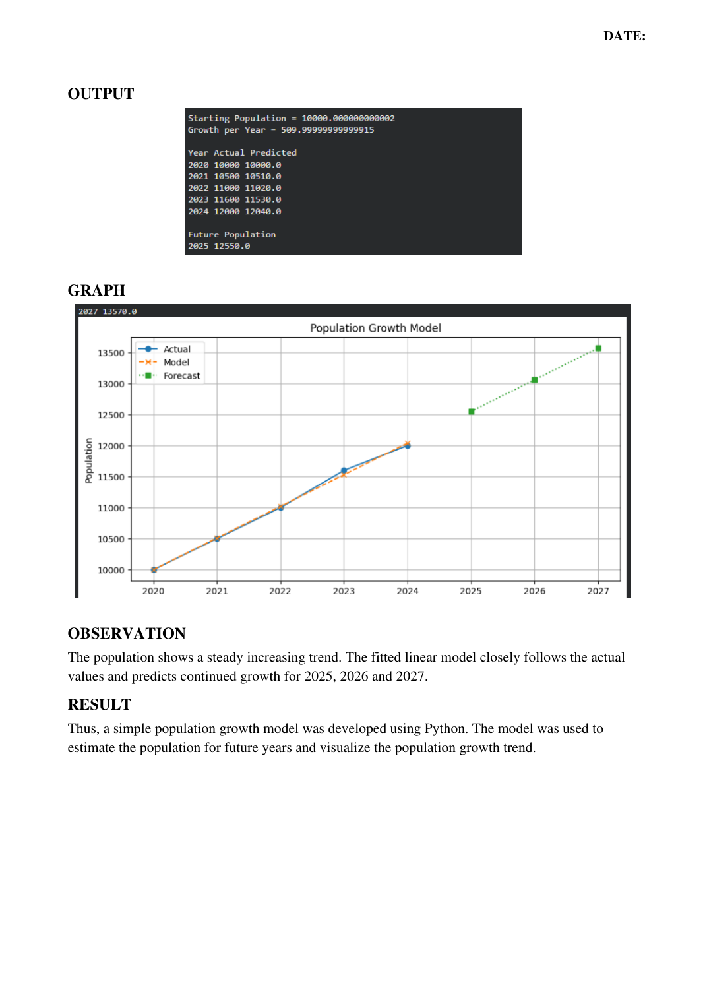

# Experiment 05 – Develop a Population Growth Model

## Student Details

- **Name:** HANIEL REENA D R
- **Register No:** 2305001008

## Aim
To develop a simple mathematical model for population growth using Python and use the model to
predict future population.

## Algorithm
1. Start the program.
2. Import NumPy and Matplotlib.
3. Enter the population data for the years 2020 to 2024.
4. Convert the years into time values starting from zero.
5. Plot the actual population data.
6. Fit a linear population growth model using np.polyfit().
7. Calculate the predicted population for the given years.
8. Predict the population for 2025, 2026 and 2027.
9. Plot the actual, model and forecast population values.
10. Display the results and stop the program.


## Python Program
File: `experiment_05.py`

```python
import numpy as np
import matplotlib.pyplot as plt
year = np.array([2020, 2021, 2022, 2023, 2024])
population = np.array([10000, 10500, 11000, 11600, 12000])
t = np.array([0, 1, 2, 3, 4])
plt.figure(figsize=(10, 5))
plt.plot(year, population, marker='o', label='Actual')
b, a = np.polyfit(t, population, 1)
predicted = a + b * t
print("Starting Population =", a)
print("Growth per Year =", b)
print("\nYear Actual Predicted")
for i in range(len(year)):
    print(year[i], population[i], round(predicted[i], 2))
future_year = np.array([2025, 2026, 2027])
future_t = np.array([5, 6, 7])
future_population = a + b * future_t
print("\nFuture Population")
for i in range(len(future_year)):
    print(future_year[i], round(future_population[i], 2))
plt.plot(year, predicted, marker='x', linestyle='--', label='Model')
plt.plot(future_year, future_population, marker='s',
         linestyle=':', label='Forecast')
plt.title("Population Growth Model")
plt.xlabel("Year")
plt.ylabel("Population")
plt.legend()
plt.grid()
plt.show()
```

## Output
### Output Page 3


## Observation
The population shows a steady increasing trend. The fitted linear model closely follows the actual
values and predicts continued growth for 2025, 2026 and 2027.

## Result
Thus, a simple population growth model was developed using Python. The model was used to
estimate the population for future years and visualize the population growth trend.

## Installation and Execution
Install the listed libraries:
```bash
pip install -r requirements.txt
```

Run the Python program from this folder:
```bash
python experiment_05.py
```

_Program and output images are transcribed/rendered from the supplied lab PDF._